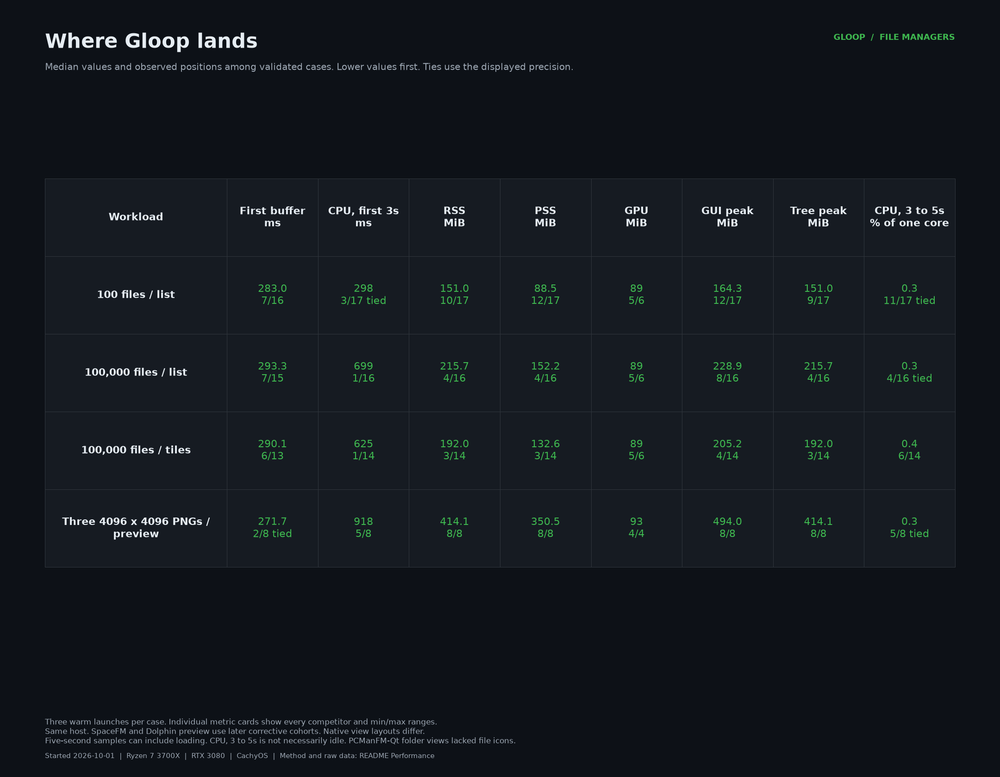

#  Gloop

A keyboard-first file manager for Linux and Wayland. Built with G# and Goo.

## Install

### AUR

Install [gloop-bin](https://aur.archlinux.org/packages/gloop-bin) with your AUR helper:

```sh
yay -S gloop-bin
```

Or
```sh
paru -S gloop-bin
``` 

See the [Arch installation guide](packaging/aur/gloop-bin/README.md)
for manual installation or migration from a portable install.

### Download

Download the [Linux release](https://github.com/obselate/gloop/releases/latest),
extract it, and run `./gloop`. No .NET runtime is needed.

Run `./gloop --help` for optional desktop integration and folder or file dialog defaults.

## Features

| Feature | Includes |
| --- | --- |
| Browse | List and tile views, thumbnails, sorting, filename filters, and clickable paths. |
| Preview | Whole images and text, with word wrap, line numbers, and code highlighting. |
| Work with files | Multi-select, create folders, rename, copy, move, Trash, and drag between folders or apps. |
| Navigate | Bookmarks, optional split panes, and a terminal in the current folder. |
| Customize | Theme presets, an OKLCH color wheel, rebindable shortcuts, and settings that apply immediately. |

Copy works across filesystems. Cross-filesystem move and Trash report an error
and preserve the source. Remote filesystems are not implemented.

## Requirements

Linux x86-64, glibc 2.39 or newer, Wayland, and Vulkan 1.3 drivers.
Tested on KDE Plasma.

## Build from source

To compile Gloop yourself, follow the [source build guide](BUILD.md).

## Performance

<details>
<summary>File manager comparison, started October 1, 2026</summary>

Gloop 0.7.2 Size was compared with 16 Linux graphical file managers using the
same local folders. The comparison covers local browsing, large-folder list and
icon views, and an integrated selected-image preview where supported. It does
not compare networking, file operations, search, or feature completeness.

Gloop has the lowest first-three-second CPU time in both 100,000-file views
among validated cases. Its five-second RSS is fourth of 16 in list view and
third of 14 in tile view. Image-preview RSS is highest of the eight validated
cases. These are observed positions on this host, with the limits below.



**Competitors and tested versions**

| File manager | Tested version |
| --- | --- |
| [Dolphin](https://apps.kde.org/dolphin/) | 26.08.1-1.1 |
| [GNOME Files](https://apps.gnome.org/Nautilus/) | 50.3.1-1.1 |
| [Thunar](https://docs.xfce.org/xfce/thunar/start) | 4.20.10-1.1 |
| [Caja](https://github.com/mate-desktop/caja/releases) | 1.28.0-4.1 |
| [PCManFM-Qt](https://github.com/lxqt/pcmanfm-qt/releases/tag/2.4.1) | 2.4.1-1.1 |
| [PCManFM](https://github.com/lxde/pcmanfm/tree/1.4.0) | 1.4.0-2.1 |
| [Krusader](https://krusader.org/) | 2.9.0-2 |
| [Double Commander Qt6](https://github.com/doublecmd/doublecmd/releases/tag/v1.2.9) | 1.2.9-1 |
| [COSMIC Files](https://github.com/pop-os/cosmic-files/tree/epoch-1.9.0) | 1:1.9.0-1.1 |
| [elementary Files](https://github.com/elementary/files/releases/tag/7.3.2) | 7.3.2-2.1 |
| [Nemo](https://github.com/linuxmint/nemo/tree/6.6.4) | 6.6.4-1.1 |
| [Flea](https://github.com/thisisgm/flea/releases/tag/v0.3.7) | 0.3.7 |
| [Strata](https://github.com/lgse/strata/releases/tag/v0.20.1) | 0.20.1 |
| [Konqueror](https://apps.kde.org/konqueror/) | 26.08.1-1.1 |
| [SpaceFM](https://github.com/IgnorantGuru/spacefm/tree/1.0.6) | 1.0.6-9 |
| [Xfe](https://sourceforge.net/projects/xfe/) | 2.0.1-2 |

These are the exact tested packages. GNOME Files 51.0.1 and Xfe 2.1.11 were
available upstream on the research date. Caja had a newer odd-series 1.29.1
tag. Package URLs, checksums, and source notes are retained in
[the package lock](assets/performance/file-managers-2026-10-01/packages.lock.json)
and [the source roster](assets/performance/file-managers-2026-10-01/sources.json).
SpaceFM uses GTK3 on Wayland. Xfe uses XWayland and has no comparable native
Wayland first-buffer measurement.

**Measurements and PNG cards**

Values are medians of three warm launches. Individual cards show the minimum
and maximum as whiskers. Positions use the displayed precision, include ties,
and apply only to validated cases with available telemetry. There is no combined
score. An asterisk marks loading at five seconds in at least one launch. A plus
marks no captured window at five seconds in at least one launch, with a populated
window validated later. A plus takes precedence when states differ. These markers
do not change the numerical three-second or five-second samples.

| Metric | GitHub dark PNG |
| --- | --- |
| First native Wayland buffer | [Card](assets/performance/file-managers-2026-10-01/cards/first_buffer_ms.png) |
| CPU time, first 3 seconds | [Card](assets/performance/file-managers-2026-10-01/cards/cpu_first_3s_ms.png) |
| RSS, around 5 seconds | [Card](assets/performance/file-managers-2026-10-01/cards/rss_mib.png) |
| PSS, around 5 seconds | [Card](assets/performance/file-managers-2026-10-01/cards/pss_mib.png) |
| GPU memory, around 5 seconds | [Card](assets/performance/file-managers-2026-10-01/cards/gpu_mib.png) |
| Main GUI process high-water RSS, first 5 seconds | [Card](assets/performance/file-managers-2026-10-01/cards/main_process_vmhwm_mib.png) |
| Process-tree peak RSS, first 5 seconds | [Card](assets/performance/file-managers-2026-10-01/cards/scope_peak_rss_mib.png) |
| CPU activity, seconds 3 to 5 | [Card](assets/performance/file-managers-2026-10-01/cards/cpu_3_to_5_percent.png) |
| Launch executable size | [Card](assets/performance/file-managers-2026-10-01/cards/executable_size.png) |
| Source build time | [Card](assets/performance/file-managers-2026-10-01/cards/publish_time.png) |
| Workload coverage and window states | [Card](assets/performance/file-managers-2026-10-01/cards/coverage.png) |

Values are medians of three accepted warm launches where that metric is comparable. N/A includes unsupported profiles, incomplete cases, and missing telemetry. State describes five-second captures or incomplete cases.

**100 files / list**

| File manager | State | First buffer (ms) | CPU first 3 s (ms) | RSS (MiB) | PSS (MiB) | GPU (MiB) | GUI peak (MiB) | Tree peak (MiB) | CPU 3-5 s (%) |
| --- | --- | --- | --- | --- | --- | --- | --- | --- | --- |
| Dolphin | Populated at 5s | 189.9 | 294 | 150.0 | 46.7 | N/A | 107.2 | 160.2 | 0.2 |
| GNOME Files | Populated at 5s | 427.3 | 643 | 270.4 | 134.3 | 36 | 226.2 | 270.4 | 0.3 |
| Thunar | Populated at 5s | 248.5 | 432 | 124.6 | 42.6 | N/A | 56.8 | 124.6 | 0.2 |
| Caja | Populated at 5s | 276.6 | 764 | 136.2 | 48.5 | N/A | 65.9 | 136.3 | 0.2 |
| PCManFM-Qt | Populated at 5s | 393.5 | 469 | 98.1 | 30.1 | N/A | 61.7 | 98.1 | 0.2 |
| PCManFM | Populated at 5s | 181.3 | 317 | 122.6 | 41.7 | N/A | 55.5 | 122.6 | 0.2 |
| Krusader | Populated at 5s | 445.6 | 915 | 123.8 | 46.9 | N/A | 96.7 | 123.8 | 0.2 |
| Double Commander Qt6 | Populated at 5s | 269.0 | 323 | 128.3 | 69.9 | N/A | 128.8 | 128.3 | 0.2 |
| COSMIC Files | Populated at 5s | 388.2 | 427 | 168.7 | 93.3 | 80 | 165.3 | 168.7 | 0.3 |
| elementary Files | Populated at 5s | 382.2 | 739 | 216.6 | 87.0 | N/A | 80.6 | 219.7 | 0.2 |
| Nemo | Populated at 5s | 640.5 | 1,105 | 179.6 | 87.5 | N/A | 112.6 | 181.7 | 0.2 |
| Flea | Populated at 5s | 579.3 | 703 | 303.6 | 171.4 | 91 | 305.0 | 310.3 | 0.3 |
| Strata | Populated at 5s | 554.7 | 780 | 236.7 | 135.9 | 28 | 224.2 | 274.9 | 0.5 |
| Konqueror | Populated at 5s | 1,206.0 | 1,712 | 646.7 | 333.0 | 27 | 396.1 | 646.7 | 0.3 |
| SpaceFM | Populated at 5s | 188.7 | 298 | 119.8 | 48.5 | N/A | 80.2 | 119.8 | 0.2 |
| Xfe | Populated at 5s | N/A | 259 | 26.5 | 10.5 | N/A | 24.1 | 26.5 | 0.4 |
| Gloop | Populated at 5s | 283.0 | 298 | 151.0 | 88.5 | 89 | 164.3 | 151.0 | 0.3 |

**100,000 files / list**

| File manager | State | First buffer (ms) | CPU first 3 s (ms) | RSS (MiB) | PSS (MiB) | GPU (MiB) | GUI peak (MiB) | Tree peak (MiB) | CPU 3-5 s (%) |
| --- | --- | --- | --- | --- | --- | --- | --- | --- | --- |
| Dolphin | Populated at 5s | 198.8 | 5,659 | 274.7 | 167.8 | N/A | 221.9 | 274.7 | 0.2 |
| GNOME Files | Populated at 5s | 414.7 | 3,737 | 432.1 | 294.6 | 36 | 389.5 | 432.2 | 0.3 |
| Thunar | Populated at 5s | 237.7 | 3,814 | 488.4 | 407.2 | N/A | 421.1 | 488.7 | 110.5 |
| Caja | Loading at 5s | 280.1 | 4,581 | 244.6 | 158.7 | N/A | 173.7 | 244.6 | 138.3 |
| PCManFM-Qt | Loading at 5s | 393.0 | 3,127 | 519.0 | 450.8 | N/A | 482.4 | 519.0 | 99.4 |
| PCManFM | Loading at 5s | 195.6 | 3,693 | 127.6 | 45.1 | N/A | 58.8 | 127.6 | 120.2 |
| Krusader | Populated at 5s | 1,265.3 | 1,723 | 230.8 | 153.0 | N/A | 203.8 | 230.8 | 0.3 |
| Double Commander Qt6 | Populated at 5s | 277.7 | 2,525 | 249.7 | 187.2 | N/A | 234.1 | 249.7 | 0.2 |
| COSMIC Files | Loading at 5s | 410.5 | 3,306 | 251.2 | 175.8 | 48 | 247.8 | 251.2 | 98.1 |
| elementary Files | Incomplete (deadline); Loading at 5s | N/A | N/A | N/A | N/A | N/A | N/A | N/A | N/A |
| Nemo | Loading at 5s | 619.0 | 4,156 | 248.4 | 153.8 | N/A | 178.9 | 248.4 | 132.4 |
| Flea | Populated at 5s | 550.8 | 721 | 301.3 | 167.2 | 91 | 300.1 | 308.1 | 0.2 |
| Strata | Populated at 5s | 563.5 | 973 | 284.2 | 181.8 | 28 | 271.8 | 284.2 | 0.6 |
| Konqueror | Loading at 5s | 1,341.1 | 3,852 | 718.5 | 401.0 | 27 | 465.3 | 718.5 | 114.7 |
| SpaceFM | Populated at 5s | 198.6 | 3,117 | 180.9 | 109.2 | N/A | 139.3 | 180.9 | 99.1 |
| Xfe | Late window | N/A | 1,924 | 33.4 | 17.4 | N/A | 31.0 | 33.4 | 68.2 |
| Gloop | Populated at 5s | 293.3 | 699 | 215.7 | 152.2 | 89 | 228.9 | 215.7 | 0.3 |

**100,000 files / tiles**

| File manager | State | First buffer (ms) | CPU first 3 s (ms) | RSS (MiB) | PSS (MiB) | GPU (MiB) | GUI peak (MiB) | Tree peak (MiB) | CPU 3-5 s (%) |
| --- | --- | --- | --- | --- | --- | --- | --- | --- | --- |
| Dolphin | Populated at 5s | 194.3 | 6,273 | 268.9 | 161.4 | N/A | 216.2 | 268.9 | 0.2 |
| GNOME Files | Populated at 5s | 413.2 | 3,771 | 420.4 | 287.7 | 36 | 381.4 | 424.7 | 0.3 |
| Thunar | Loading at 5s | 245.7 | 4,039 | 433.2 | 350.4 | N/A | 363.8 | 433.2 | 99.7 |
| Caja | Loading at 5s | 286.2 | 4,624 | 246.6 | 160.6 | N/A | 173.2 | 246.6 | 140.1 |
| PCManFM-Qt | Populated at 5s | 391.7 | 2,816 | 502.9 | 434.5 | N/A | 467.6 | 504.3 | 0.2 |
| PCManFM | Incomplete (deadline); Loading at 5s | N/A | N/A | N/A | N/A | N/A | N/A | N/A | N/A |
| Krusader | N/A (unsupported profile) | N/A | N/A | N/A | N/A | N/A | N/A | N/A | N/A |
| Double Commander Qt6 | Populated at 5s | 278.3 | 2,650 | 242.6 | 183.2 | N/A | 227.0 | 242.6 | 0.2 |
| COSMIC Files | Loading at 5s | 415.6 | 3,311 | 247.7 | 175.1 | 48 | 244.6 | 247.7 | 97.7 |
| elementary Files | Incomplete (deadline); Loading at 5s | N/A | N/A | N/A | N/A | N/A | N/A | N/A | N/A |
| Nemo | Loading at 5s | 599.4 | 3,948 | 389.7 | 297.1 | N/A | 320.2 | 389.7 | 123.5 |
| Flea | Populated at 5s | 537.1 | 699 | 296.8 | 167.6 | 91 | 295.8 | 303.3 | 0.2 |
| Strata | Populated at 5s | 546.2 | 1,598 | 303.6 | 204.2 | 28 | 291.3 | 303.7 | 0.5 |
| Konqueror | Loading at 5s | 1,416.1 | 3,858 | 696.6 | 383.2 | 27 | 448.0 | 696.6 | 112.8 |
| SpaceFM | Populated at 5s | 183.7 | 3,118 | 187.2 | 116.6 | N/A | 147.2 | 187.4 | 84.5 |
| Xfe | Late window | N/A | 1,933 | 33.8 | 18.0 | N/A | 31.4 | 33.8 | 70.0 |
| Gloop | Populated at 5s | 290.1 | 625 | 192.0 | 132.6 | 89 | 205.2 | 192.0 | 0.4 |

**Three 4096 x 4096 PNGs / preview**

| File manager | State | First buffer (ms) | CPU first 3 s (ms) | RSS (MiB) | PSS (MiB) | GPU (MiB) | GUI peak (MiB) | Tree peak (MiB) | CPU 3-5 s (%) |
| --- | --- | --- | --- | --- | --- | --- | --- | --- | --- |
| Dolphin | Incomplete (deadline); Mixed 5s: 2 populated at 5s, 1 loading at 5s | N/A | N/A | N/A | N/A | N/A | N/A | N/A | N/A |
| GNOME Files | N/A (unsupported profile) | N/A | N/A | N/A | N/A | N/A | N/A | N/A | N/A |
| Thunar | Populated at 5s | 236.2 | 534 | 183.6 | 75.4 | N/A | 62.3 | 185.8 | 0.2 |
| Caja | N/A (unsupported profile) | N/A | N/A | N/A | N/A | N/A | N/A | N/A | N/A |
| PCManFM-Qt | N/A (unsupported profile) | N/A | N/A | N/A | N/A | N/A | N/A | N/A | N/A |
| PCManFM | N/A (unsupported profile) | N/A | N/A | N/A | N/A | N/A | N/A | N/A | N/A |
| Krusader | Populated at 5s | 439.7 | 1,267 | 173.4 | 60.7 | N/A | 103.2 | 223.6 | 0.2 |
| Double Commander Qt6 | Populated at 5s | 271.7 | 1,780 | 260.7 | 198.8 | N/A | 435.8 | 355.7 | 0.2 |
| COSMIC Files | Populated at 5s | 437.8 | 498 | 172.6 | 95.7 | 80 | 171.6 | 172.6 | 0.4 |
| elementary Files | Populated at 5s | 390.9 | 847 | 217.6 | 86.5 | N/A | 125.3 | 247.5 | 0.2 |
| Nemo | N/A (unsupported profile) | N/A | N/A | N/A | N/A | N/A | N/A | N/A | N/A |
| Flea | Populated at 5s | 566.8 | 709 | 311.8 | 169.7 | 91 | 313.7 | 319.0 | 0.3 |
| Strata | Populated at 5s | 585.0 | 1,112 | 274.3 | 143.9 | 28 | 240.4 | 287.1 | 1.6 |
| Konqueror | N/A (unsupported profile) | N/A | N/A | N/A | N/A | N/A | N/A | N/A | N/A |
| SpaceFM | N/A (unsupported profile) | N/A | N/A | N/A | N/A | N/A | N/A | N/A | N/A |
| Xfe | N/A (unsupported profile) | N/A | N/A | N/A | N/A | N/A | N/A | N/A | N/A |
| Gloop | Populated at 5s | 271.7 | 918 | 414.1 | 350.5 | 93 | 494.0 | 414.1 | 0.3 |

**Method and limits**

The fixtures contain 100 and 100,000 zero-byte text files, plus three fixed
4096x4096 RGB PNGs. The image workload selects the first PNG and opens an
integrated preview. Each profile opens one fixture tab. In the folder workloads,
Krusader and Double Commander retain a second empty browsing pane. elementary
Files has tab restoration disabled. SpaceFM uses `--no-saved-tabs` to keep one
fixture tab between launches. Layouts and preview areas follow each application's
native controls. External preview applications were not measured.
PCManFM-Qt showed file labels and native counts with missing file icons in
these profiles. This is retained as a visual qualification.
Unsupported profiles are N/A, rather
than a claim that an application has no possible preview extension.

Runs use an AMD Ryzen 7 3700X, NVIDIA RTX 3080 with driver 615.71.09, 64 GiB RAM,
Btrfs, and CachyOS Linux 7.2.7. Each launch has a private D-Bus session and an
owned process cgroup inside a private KWin Wayland session. Output is 1440x900
at scale 1. The outer window frame is 1180x760. Client image dimensions vary
with decorations and shadows. Required desktop services are warmed before the
launch gate. Profiles and caches are isolated from the user's configuration.
Package overlays use the recorded host libraries, rather than a closed runtime
bundle for each manager.

The main cohort has 59 functional warmups and 177 fixed measured slots. Its
isolated application profiles and caches persist between launches. All original
SpaceFM results are withdrawn because saved tabs changed its workload. Dolphin's
three original preview results are also withdrawn because a repeated shortcut
closed its saved preview panel. Its three folder workloads use separate profiles
and retain their main-cohort measurements. A separate fresh
SpaceFM cohort has three warmups and nine measured slots using the corrected
launch option. A fresh Dolphin preview cohort has one warmup and three measured
slots. It seeds the native preview-panel state before each launch and selects
the image with the same click. The preview panel starts open.
Both corrections use the same pinned binary, host, fixtures, sampler, sampling
windows, baseline and geometry. Profiles and caches persist after their warmup.
One corrected Dolphin launch showed folder information instead of the selected
image. All three observations remain recorded and the whole preview case is
unranked. The other two launches are not used as a substitute median.
The joined comparison selects one source per application and workload from these
three cohorts. It does not share one balanced launch order.
Every attempt is retained.
The raw profile hash snapshot is recorded before scope cleanup. Normal window
close can update preferences, and those changes persist into the next launch.
Prelaunch quiet timeouts defer the slot without starting an application. After
application launch, only external contamination permits a replacement attempt.
Slow results do not. An input-deadline failure can close its slot after explicit review of the
failed record and matching frozen end snapshots. Its missing telemetry stays
N/A, the failed attempt remains, and later slots continue. A case with fewer
than three usable launches has no metric positions. All large-folder cases
retain a later validation image at about 20 seconds.
Xfe, elementary Files, and Konqueror retain it at about 120 seconds. This later
image can establish population but cannot change the earlier resource samples.
Cases still incomplete at their deadline retain their measurements in the raw
data and have no metric positions. Capture review checks visible fixture entries
or selected image pixels and visible loading indicators. It does not instrument
each manager's directory model.

First buffer is launch to the first non-null buffer attachment on the owned
application toplevel observed in the client trace. Startup attribution requires
an owned five-second window capture. A later window does not fill missing
first-buffer telemetry. It includes trace delivery overhead and does not measure
presentation or directory readiness. Raw CPU uses
the owned cgroup's microsecond accounting. The adjusted process-tick diagnostic
has 10 ms resolution on this host. Raw CPU includes the prewarmed
desktop services and benchmark supervisor. An adjusted CPU diagnostic is also
retained. RSS, PSS, GPU memory, and process-tree RSS exclude prelaunch services.
Application helpers are included, such as Flea's Rust and QuickShell processes
and Thunar's private Tumbler service. RSS can count shared pages repeatedly.
PSS divides those pages between processes. GPU memory excludes the compositor.
Missing per-process GPU telemetry is N/A, never zero.

The GUI peak is the owned GUI process's `VmHWM` within the first five seconds,
excluding helpers. The process-tree peak is the largest simultaneous summed RSS
sample, collected about every 100 ms. Short peaks can be missed. The separate
sum of process high-water values in the raw data is an upper bound, not a true
combined peak. CPU during seconds 3 to 5 is a fixed interval that can include
loading. CPU time sums usage across logical cores. In the percentage metric,
100% means one logical core, so values can exceed 100%. A displayed 0.0% is
rounded and does not establish zero activity or idle readiness.

No inference activity was present during the final setup baseline. The model
process is monitored by name so a restarted process can be detected. Launches
require ten quiet seconds, at least 512 MiB free GPU memory, and global GPU
utilization no higher than 50% before launch. The cap was fixed from an app-free
60-second baseline inside the same private compositor: nearest-rank p95 45%, rounded up
to the next ten percentage points. Ordinary desktop GPU activity remains. This
is a shared-host warm-cache comparison, not a cold-start or idle-GPU benchmark.

Gloop uses the exact released NativeAOT Size executable, 17,615,832 bytes, with
SHA-256 `28c9cc2f583c94db4e67c40224cf92a073e66cff8147ca8c204cddf3722ca6bd`.
Its staged copy has a separate inode. The executable-size card covers only each
launch executable. Other managers require external libraries, runtimes, assets,
and plugins, so this card does not rank complete installation size. Runtime
measurements use the released Gloop executable and prebuilt competitor packages.

**Source build time**

Source builds use the corresponding upstream versions on the same CachyOS host,
without reproducing distribution patches. Each timed command runs with affinity
to logical CPUs 0 and 1, a 200% CPU quota, an 8 GiB memory limit, and no network.
Source downloads, dependency preparation, configuration, and restore are excluded.
Each successful result is one clean build observation. Toolchains and build scopes
differ, so these durations have no metric positions. Private build-tool prefixes,
compiler and linker flags, and per-application caches are recorded. Cache content
is checked before timing, and build-time changes are recorded.

| File manager | Clean source build |
| --- | ---: |
| Gloop | 26.494 s |
| Dolphin | 263.711 s |
| GNOME Files | 36.280 s |
| Thunar | 17.346 s |
| Caja | 29.352 s |
| PCManFM-Qt | 31.646 s |
| PCManFM | 1.399 s |
| Krusader | 209.622 s |
| Double Commander Qt6 | 35.863 s |
| COSMIC Files | 532.834 s |
| elementary Files | 24.763 s |
| Nemo | 36.628 s |
| Flea | 37.875 s |
| Strata | 459.394 s |
| Konqueror | 303.925 s |
| SpaceFM | 6.934 s |
| Xfe | 25.068 s |

All 17 selected builds succeeded. The history retains 37 launched attempts,
including 20 failures. Failed attempts contribute no published duration.
SpaceFM uses GNU C17 and the recorded legacy GCC compatibility flags.

Gloop's local NativeAOT Size publish took 26.494 seconds with SDK 10.0.401.
This times raw `dotnet publish`, before packaging cleanup and checks. Its main ELF
is separate from the released binary used for runtime measurements and is not a
distributable release. The earlier 30.249-second Ubuntu
24.04 observation remains in the Gloop-only section below. Flea's duration covers
its Rust executable. Four absolute QML asset aliases are omitted during extraction,
so this build does not establish a standalone usable Flea UI. Double
Commander's command also builds plugins and performs post-link stripping. Full
commands, scopes, toolchains, prerequisite corrections, and failed attempts are
retained in [the source-build report](assets/performance/file-managers-2026-10-01/source-builds.json).

The final cohort starts with fresh profiles and 59 functional warmups. It
imports no earlier records or profiles. After those checks, the host's NodeJS
package changed from 26.10.0-1 to 26.10.0-2. The first measured invocation
stopped at the provenance check before launching an application. The original
inputs, warmups, and failed invocation remain archived. A real no-launch
preflight pinned the current host for all 177 measurements. The warmups check
views and warm profiles only and contribute no numeric values. No Node
process or direct Node library dependency was observed in the audited app
records and executables. This supports the rebase but is not exhaustive tracing
of short-lived helpers. Each measured invocation checks the current pinned
host before and after its application launch. The
[rebase ledger](assets/performance/file-managers-2026-10-01/results/cohorts/main/provenance-rebase/ledger.json)
links the preserved inputs and preflight evidence.

Each invocation launches one application as a detached user service and retains
its wrapper log. Earlier setup cohorts are excluded. They retain crashes,
input and screenshot mapping errors, interrupted wrappers, and cache recovery
evidence. One interrupted warmup had no completed raw or end record. Two
partial screenshots were overwritten before archive and survive only as
historical hash observations.

An earlier cohort's entire 17-run measured prefix was withdrawn after
elementary Files restored an extra fixture tab on each launch. An exact private
profile clone confirmed the growth. Disabling tab restoration retained one
populated tab across a fresh warmup and three fixed control launches. The
earlier records, captures, and end snapshots remain unchanged and contribute
no values or positions to this comparison. The control launches are also
excluded. [Setup evidence](assets/performance/file-managers-2026-10-01/setup-evidence.json)
records the failures, corrections, and source hashes.

**Data and reproduction**

The joined report contains 68 application/workload rows: 55 validated cases,
four incomplete cases, and nine unsupported profiles. It selects 177 measured
observations. The 12 superseded main-cohort observations remain in their original
raw data alongside the later corrective runs.

- [Summary CSV](assets/performance/file-managers-2026-10-01/results/composite/summary.csv) and [JSON](assets/performance/file-managers-2026-10-01/results/composite/summary.json).
- [Source selection and checksums](assets/performance/file-managers-2026-10-01/results/source-map.json).
- Source builds: [results and commands](assets/performance/file-managers-2026-10-01/source-builds.json), [all 37 attempts](assets/performance/file-managers-2026-10-01/source-build-attempts.jsonl), and [provenance](assets/performance/file-managers-2026-10-01/source-build-provenance.json).
- Main cohort [raw records](assets/performance/file-managers-2026-10-01/results/cohorts/main/raw.jsonl) and [captures](assets/performance/file-managers-2026-10-01/results/cohorts/main/captures).
- SpaceFM correction [raw records](assets/performance/file-managers-2026-10-01/results/cohorts/spacefm/raw.jsonl) and [captures](assets/performance/file-managers-2026-10-01/results/cohorts/spacefm/captures).
- Dolphin preview correction [raw records](assets/performance/file-managers-2026-10-01/results/cohorts/dolphin_preview/raw.jsonl) and [captures](assets/performance/file-managers-2026-10-01/results/cohorts/dolphin_preview/captures).

The tracked [package extractor](scripts/file_manager_packages.py),
[fixture generator](scripts/file_manager_fixtures.py),
[manifest resolver](scripts/prepare_file_manager_cohort.py),
[session wrapper](scripts/file_manager_session.py), and
[sampler](scripts/file_manager_cohort.py) support another recorded cohort.
The [source-build runner](scripts/file_manager_source_builds.py) uses the
[pinned source manifest](assets/performance/file-managers-2026-10-01/source-builds.template.json).
Run on a compatible Linux host with Wayland, KWin, Vulkan and the recorded
runtime and build tools. Record a new app-free baseline, inspect every warmup,
and review the captured workloads before assigning positions.

Regenerate the cards from the exported measurements:

```sh
python3 scripts/render_performance_cards.py \
  assets/performance/file-managers-2026-10-01/results/composite/summary.json \
  assets/performance/file-managers-2026-10-01/results/composite/inputs/composite-manifest.json \
  --build-results assets/performance/file-managers-2026-10-01/source-builds.json \
  --output artifacts/performance/cards
```

</details>

<details>
<summary>Gloop v0.7.2 measurements, October 1, 2026</summary>

The released NativeAOT Size executable is 14.2% smaller than Gloop 0.7.1
(`c0efcfe`). It embeds 53 required Material icons instead of the full 4,128,
uses packed Linux relocations, and reduces directory and preview work.
Delivery remains one executable with embedded third-party notices.

**Publishing on Ubuntu 24.04**

| Build | Executable | Publish time |
| --- | ---: | ---: |
| 0.7.1, Size | 20,534,288 bytes | 26.735 s |
| 0.7.2, Size | 17,615,832 bytes | 30.249 s |
| 0.7.2, Speed | 18,572,856 bytes | 22.188 s |

Each profile has one fresh warm-payload publish observation using .NET SDK
10.0.401, limited to two CPUs and 8 GiB RAM. Timing covers `dotnet publish`
only, excluding restore and packaging checks. Speed ran after Size and may
reuse intermediates. These single observations do not establish publish-time
improvements. Both 0.7.2 profiles require GLIBC_2.38, within the supported
2.39 baseline. The separate release CI Size publish took 30.736 s on its
unrestricted runner and is not part of this controlled comparison.

**Matched warm launches**

| Workload | Build | First buffer | CPU, first 3 s | RSS | PSS | GPU memory |
| --- | --- | ---: | ---: | ---: | ---: | ---: |
| 100 files, list | 0.7.1 Size | 294.39 ms | 300 ms | 148.7 MiB | 92.0 MiB | 89 MiB |
| 100 files, list | 0.7.2 Size | 334.87 ms | 340 ms | 147.9 MiB | 88.0 MiB | 89 MiB |
| 100 files, list | 0.7.2 Speed | 341.30 ms | 340 ms | 147.3 MiB | 90.6 MiB | 89 MiB |
| 100,000 files, list | 0.7.1 Size | 381.28 ms | 790 ms | 230.6 MiB | 173.7 MiB | 89 MiB |
| 100,000 files, list | 0.7.2 Size | 369.30 ms | 740 ms | 218.3 MiB | 158.2 MiB | 89 MiB |
| 100,000 files, list | 0.7.2 Speed | 303.47 ms | 660 ms | 218.2 MiB | 161.4 MiB | 89 MiB |
| 100,000 files, tiles | 0.7.1 Size | 407.87 ms | 860 ms | 200.1 MiB | 143.5 MiB | 89 MiB |
| 100,000 files, tiles | 0.7.2 Size | 367.63 ms | 750 ms | 188.3 MiB | 128.3 MiB | 89 MiB |
| 100,000 files, tiles | 0.7.2 Speed | 373.46 ms | 700 ms | 188.3 MiB | 131.6 MiB | 89 MiB |
| Three 4096x4096 PNGs, preview open | 0.7.1 Size | 359.56 ms | 1,580 ms | 421.0 MiB | 362.7 MiB | 153 MiB |
| Three 4096x4096 PNGs, preview open | 0.7.2 Size | 305.81 ms | 960 ms | 410.0 MiB | 348.5 MiB | 93 MiB |
| Three 4096x4096 PNGs, preview open | 0.7.2 Speed | 268.65 ms | 910 ms | 410.0 MiB | 351.7 MiB | 93 MiB |

**v0.7.2 process peak RSS and CPU during seconds 3 to 5**

| Workload | Size peak RSS | Speed peak RSS | Size CPU, 3 to 5 s | Speed CPU, 3 to 5 s |
| --- | ---: | ---: | ---: | ---: |
| 100 files, list | 161.2 MiB | 160.5 MiB | 0.5% | 0.0% |
| 100,000 files, list | 231.6 MiB | 231.4 MiB | 0.0% | 0.0% |
| 100,000 files, tiles | 201.8 MiB | 201.7 MiB | 0.0% | 0.0% |
| Three 4096x4096 PNGs, preview open | 490.2 MiB | 490.0 MiB | 0.0% | 0.0% |

Peak RSS is the median process `VmHWM` through the five-second sample.
CPU is the median percentage of one core during the three-to-five-second
interval. A displayed 0.0% does not establish zero CPU use outside that interval.
Image decoding still needs a temporary full raster. The Size image case
reached 490.2 MiB peak RSS, compared with 513.3 MiB for 0.7.1. Bounding preview
dimensions reduces retained image and GPU data but does not eliminate this
decoding cost.

**Why Size remains the default**

Speed adds 957,024 bytes (5.4%). It used 50 to 80 ms less CPU in the large-folder
and image cases, while first-buffer results were mixed. Size keeps the smaller
executable. Three runs on a shared host do not establish a consistent startup
advantage for either profile or a general startup improvement over 0.7.1.

Measured on an AMD Ryzen 7 3700X, NVIDIA RTX 3080 with driver 615.71.09,
64 GiB RAM, Btrfs, and CachyOS Linux 7.2.7. Each runtime value is the median
of three warm launches with alternating build order. Each build received one
warmup before each benchmark group (list, tiles, and images). The list group
warmed up on 100 files before measuring both folder sizes. Runs used a private
KWin Wayland compositor, a 1180x760 window, 1440x900 output at scale 1, and no
Goo developer tools. GC tuning overrides were unset.

First buffer measures process launch to the first non-null Wayland buffer
attachment observed in the client trace. It includes trace delivery overhead
and does not measure presentation, directory readiness, or preview readiness.
CPU time covers approximately the first three seconds, with 10 ms accounting
resolution. RSS and PSS were sampled around five seconds. They exclude GPU
and compositor memory. GPU values are per-process samples, not peaks.
These shared-host, warm-cache results do not establish cold-start performance
or a ranking against other file managers.

The initial tile cohort stopped when the historical 0.7.1 baseline failed to
create a Vulkan swapchain. Its incomplete data were excluded, and the full
matched cohort was repeated once. All 36 measured launches and nine warmups
in the completed cohorts passed. The cause of the initial failure is unknown.

Source: [v0.7.2](https://github.com/obselate/gloop/tree/v0.7.2), commit
`18abcdf769498e1923481f513eccd5cbae6749b8`, using Goo and Goo.Svg 0.7.13,
Goo.Widgets 0.2.13, and Goo.Animations 0.2.5. Runtime Size measurements used
the exact downloaded release executable, also installed locally, with SHA-256
`28c9cc2f583c94db4e67c40224cf92a073e66cff8147ca8c204cddf3722ca6bd`.
Speed was rebuilt from the same tag with the Speed profile. The exact release
executable passed Wayland visual, keyboard, scrolling, preview, split-pane,
and selection checks.

</details>

## Links

- [Downloads and release notes](https://github.com/obselate/gloop/releases)
- [Goo UI framework](https://github.com/obselate/goo)
- [Report an issue](https://github.com/obselate/gloop/issues)
- [MIT license](LICENSE)
